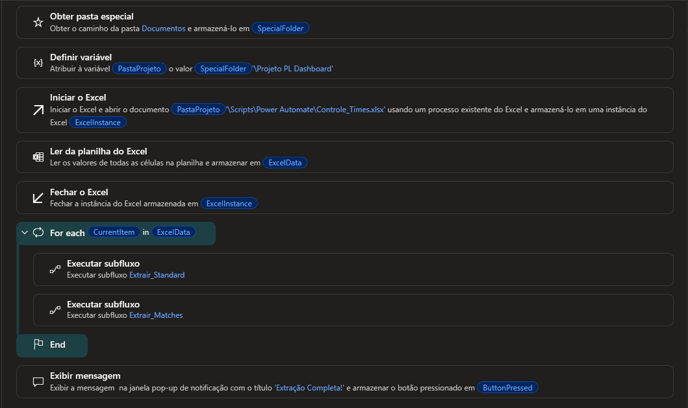
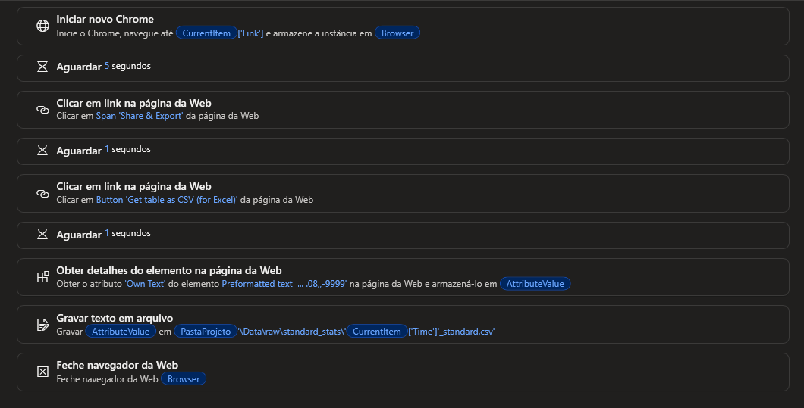

# Coleta de dados com Power Automate Desktop

Esta pasta contém a automação que faz a **primeira etapa do pipeline**: extrair do [FBref](https://fbref.com) as estatísticas dos jogadores e os resultados das partidas de cada time da Premier League 2025-26.

```
Power Automate Desktop  →  Data/raw  →  limpeza (Python)  →  Database  →  PostgreSQL  →  Power BI
        (esta pasta)
```

---

## O que o fluxo faz

1. Abre a planilha `Controle_Times.xlsx` e lê a lista dos 20 times.
2. Para cada time:
   - **Extrair_Standard:** abre a página do time e extrai a tabela *Standard Stats* (estatísticas dos jogadores).
   - **Extrair_Matches:** abre a página de jogos do time e extrai a tabela *Scores & Fixtures* (partidas da Premier League).
3. Salva cada tabela como CSV em `Data/raw/`.
4. Exibe a mensagem "Extração Completa!" ao terminar.

Ao final, são gerados 40 arquivos: 20 de jogadores e 20 de partidas.

---

## Estrutura da pasta

```
Power Automate/
├── README.md
├── Controle_Times.xlsx        ← lista de times e links (entrada do fluxo)
├── export/                    ← código dos fluxos, para importar no PAD
│   ├── Main.txt
│   ├── Extrair_Standard.txt
│   └── Extrair_Matches.txt
└── prints/                    ← imagens dos fluxos no designer
    ├── Main.png
    ├── Extrair_Standard.png
    └── Extrair_Matches.png
```

---

## Entrada: `Controle_Times.xlsx`

| Coluna | Conteúdo | Exemplo |
|---|---|---|
| `ID` | Código do time no FBref | `18bb7c10` |
| `Time` | Nome do time, usado no nome do arquivo gerado | `Arsenal` |
| `Link` | Página do time na temporada (fórmula montada a partir do ID) | `https://fbref.com/en/squads/18bb7c10/2025-2026/` |
| `Link 2` | Página de jogos do time na Premier League | `https://fbref.com/en/squads/18bb7c10/2025-2026/matchlogs/c9/schedule/` |

Para coletar outra temporada, basta trocar `2025-2026` nas fórmulas dos links.

---

## Saída

| Subfluxo | Pasta | Nome do arquivo |
|---|---|---|
| Extrair_Standard | `Data/raw/standard_stats/` | `<Time>_standard.csv` |
| Extrair_Matches | `Data/raw/matches_stats/` | `<Time>_matches.csv` |

Os arquivos são gravados em **UTF-16** e começam com uma linha de aviso do FBref. Por isso, os scripts de limpeza leem com `encoding='utf 16'` e `skiprows=1`.

> A classificação (`Data/raw/league_standings/standings.csv`) não é coletada por este fluxo. Ela foi exportada do FBref separadamente.

---

## Como os fluxos funcionam

### Main



```text
Obter a pasta Documentos do usuário
PastaProjeto = Documentos\Projeto PL Dashboard
Abrir Controle_Times.xlsx, ler todas as linhas e fechar o Excel
Para cada time na planilha:
    Executar Extrair_Standard (time, PastaProjeto)
    Executar Extrair_Matches  (time, PastaProjeto)
Exibir "Extração Completa!"
```

O caminho do projeto é descoberto pela ação **Obter pasta especial**, então o fluxo não depende do nome de usuário do computador.

### Extrair_Standard



```text
Abrir o Chrome no link do time (coluna Link)
Aguardar 5 segundos
Abrir o menu "Share & Export" da tabela Standard Stats
Aguardar 1 segundo
Clicar em "Get table as CSV (for Excel)"
Aguardar 1 segundo
Ler o texto da tabela em CSV (elemento csv_stats_standard_9)
Gravar em Data\raw\standard_stats\<Time>_standard.csv
Fechar o navegador
```

### Extrair_Matches


Mesma lógica do Extrair_Standard, usando a coluna `Link 2`, a tabela *Scores & Fixtures* (elemento `csv_matchlogs_for`) e gravando em `Data\raw\matches_stats\<Time>_matches.csv`.

Os elementos da página são localizados pelo **Id** das tabelas do FBref, que é o mesmo para todos os times. Assim, um único conjunto de elementos capturados funciona para os 20.

---

## Como importar e executar

**Requisitos**
- Windows com [Power Automate Desktop](https://learn.microsoft.com/power-automate/desktop-flows/install)
- Google Chrome com a extensão do Power Automate ativada
- Microsoft Excel
- A pasta do projeto em `Documentos\Projeto PL Dashboard`

**Importar**
1. No Power Automate Desktop, crie um fluxo novo.
2. Crie dois subfluxos com os nomes exatos `Extrair_Standard` e `Extrair_Matches`.
3. Em cada subfluxo, cole o conteúdo do arquivo correspondente da pasta `export/`. No `Main`, cole o `Main.txt`.
4. Nos subfluxos, crie as variáveis de entrada `CurrentItem` e `PastaProjeto`, se não forem criadas automaticamente ao colar.
5. Execute o fluxo a partir do `Main`.

> O código colado já inclui os elementos da página capturados. Se o FBref mudar o layout, pode ser necessário recapturar os elementos no painel **Elementos da interface do usuário**.

---

## Limitações e melhorias futuras

- **Menu com hover:** o "Share & Export" abre ao passar o mouse, e não ao clicar. O clique funciona porque move o mouse até o menu, mas pode falhar de vez em quando. Trocar pela ação **Passar o mouse sobre o elemento da página da Web** deixaria o fluxo mais estável.
- **Esperas fixas:** os `Aguardar` de 5 e 1 segundo poderiam ser trocados por **Aguardar conteúdo da página da Web**, combinados com uma pequena folga.
- **Limite de acessos do FBref:** o site limita requisições automáticas (cerca de 10 páginas por minuto). Uma pausa entre os times evitaria bloqueios temporários.
- **Tratamento de erros:** se um time falhar, o fluxo para. Um bloco *On error* permitiria registrar a falha e seguir para o próximo time.
- **Classificação:** incluir a extração da tabela de classificação no próprio fluxo.
- **Alternativa em Python:** a coleta poderia ser feita com `requests` e `pandas`, deixando todo o pipeline em uma única linguagem.

---

## Fonte dos dados

Dados de [FBref.com](https://fbref.com) (Sports Reference), temporada 2025-26 da Premier League. Uso para fins de estudo e portfólio, seguindo o pedido do site de citar a fonte.
